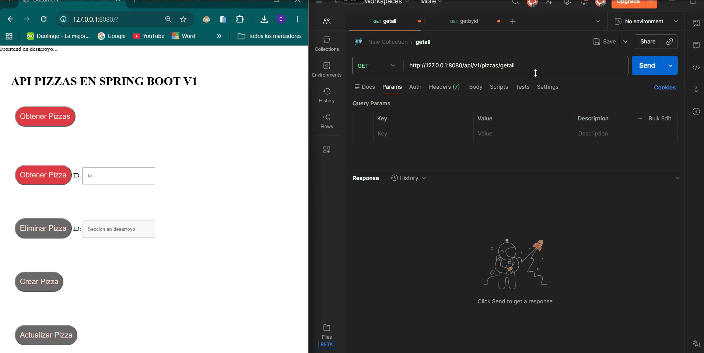
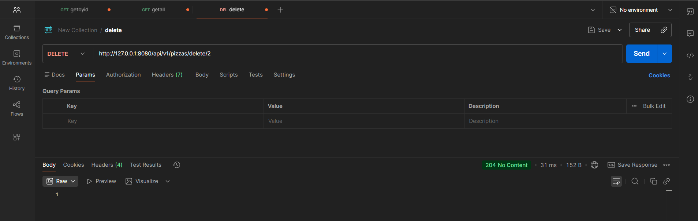
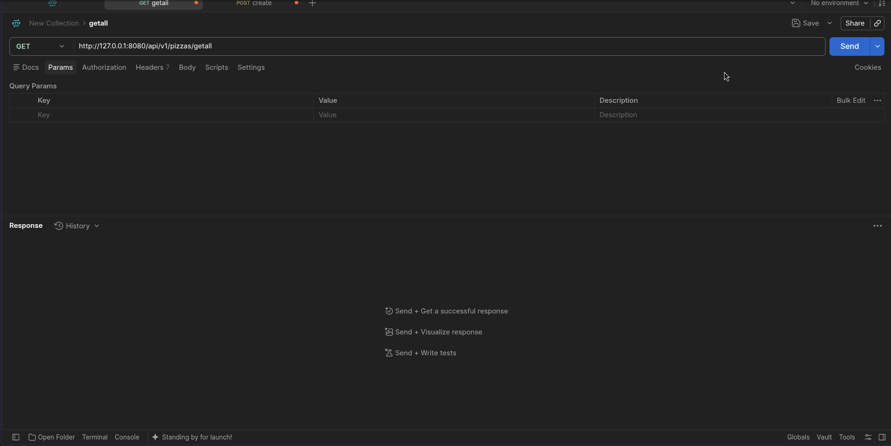

# Api de Pizzas Spring Boot (V1)

### Descripcion

API  desarrollada con SpringBoot. Permite consultar, agregar, actualizar y eliminar pizzas mediante diferentes métodos HTTP. 

Dentro de repository se hace uso de arrays y listas para simular la persistencia de datos. 

### Instalacion y ejecucion
```bash
git clone <EsteRepo>
cd backend-playground/Tareas_TEP1/ApiPizzasSpringBoot
chmod u+x mvnw
./mvnw spring-boot:run
```


# Metodos disponibles

### GET

Endpoints usados:

- Sin id: `/api/v1/pizzas/getall`
- Con id: `/api/v1/pizzas/getbyid/<idNumerico>`


### DELETE

Endpoints usados:

- Con id: `/api/v1/pizzas/delete/<idNumerico>`



### POST

Endpoints usados:

- `/api/v1/pizzas/create`




### PUT

En desarroyo...


# Api Clientes


